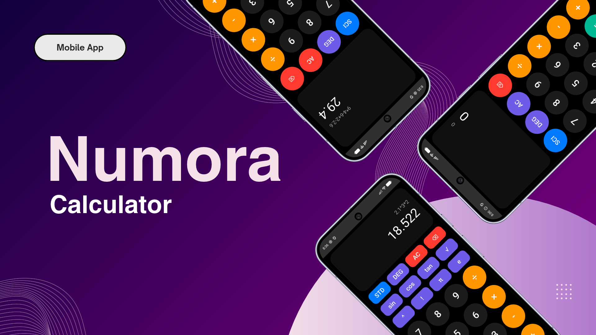

# Numora — Calculator

[-brightgreen?logo=android&logoColor=white)](https://www.android.com/)
[](https://kotlinlang.org/)
[](https://developer.android.com/jetpack/compose)
[](https://m3.material.io/)
[](https://developer.android.com/topic/architecture)
[](https://developer.android.com/build)
[](#permissions--device-requirements)
[](./LICENSE)

<p align="center">
  
</p>

Numora is an offline-first native Android scientific and standard calculator engineered with Kotlin and Jetpack Compose under Material Design 3. Designed to bridge the gap between everyday rapid calculation and complex technical computation, Numora pairs a clean, tactile standard arithmetic interface with an expandable scientific evaluation module capable of parsing complex expressions, trigonometric identities, logarithms, powers, and factorials.

At the core of Numora is a custom-built mathematical evaluation engine comprising a tokenizer (`Lexer`) and a recursive descent expression parser (`ExpressionParser`). Rather than relying on external web views or third-party scripting evaluators, Numora evaluates mathematical syntax directly in native Kotlin code, strictly adhering to operator precedence rules, unary transformations, right-associative exponentiation, implicit multiplication (such as `2π`), and parenthesis resolution. Built atop the Model-View-ViewModel (MVVM) architecture with reactive Kotlin `StateFlow` streams, the application delivers instant updates, tactile haptic feedback, fluid Compose layout animations, and dynamic auto-scaling typography across a battery-efficient AMOLED black theme. Numora enforces a strict zero-permission model: it operates completely offline with zero background services, zero tracking telemetry, and zero device permissions.

---

## Features

- **Dual-Mode Calculation Engine (Standard & Scientific)**:
  - **Standard Keypad Mode (`STD`)**: Clean four-column numeric layout tailored for fast arithmetic operations, percentages, decimals, and immediate result resolution.
  - **Scientific Keypad Mode (`SCI`)**: Expandable scientific keyboard tier featuring trigonometric functions, powers, factorials, square roots, and fundamental constants.
  - **Fluid Keypad Transitions**: Animated expand and collapse transitions driven by Jetpack Compose `AnimatedVisibility` with smooth vertical spring interpolation.
- **Robust Mathematical Syntax & Parsing**:
  - **Custom Lexical Analyzer (`Lexer`)**: Tokenizes raw character streams into structured numbers, operators, trigonometric functions, constants, and grouping tokens while stripping whitespace and validating decimal points.
  - **Recursive Descent Parser (`ExpressionParser`)**: Evaluates mathematical syntax based on formal precedence:
    - Addition and subtraction with unary minus support (`-5+3`).
    - High-precedence multiplication and division with divide-by-zero safeguards.
    - Right-associative exponentiation (e.g., `2^3^2` evaluates as $2^{(3^2)} = 512$).
    - Postfix factorial (`!`) supporting values up to 170 with overflow validation.
    - Postfix percentage (`%`) auto-scaled by 0.01.
    - Implicit multiplication for constants and parenthetical groups (e.g., `2π`, `2(5)`).
- **Trigonometric & Scientific Capabilities**:
  - Full trigonometric function set: Sine (`sin`), Cosine (`cos`), and Tangent (`tan`) with asymptote protection (`cos(x) ≈ 0`).
  - Inverse trigonometric functions: Arcsine (`asin`), Arccosine (`acos`), and Arctangent (`atan`).
  - **Angle Mode Switching (`DEG` ↔ `RAD`)**: Instant toggle between Degree mode (default) and Radian mode with automatic degree-to-radian conversion during evaluation.
  - Logarithmic calculations: Common base-10 logarithm (`log`) and Natural logarithm (`ln`).
  - Pre-programmed mathematical constants: Archimedes' constant $\pi$ (`Math.PI`) and Euler's number $e$ (`Math.E`).
- **High-Precision Formatting**:
  - Precision decimal scaling via `BigDecimal` rounding (`RoundingMode.HALF_UP` up to 12 decimal places) with automatic trailing zero stripping.
  - Automatic scientific notation formatting (`%.10E`) for astronomical magnitudes ($\ge 10^{12}$) and microscopic values ($< 10^{-10}$).
  - Negative-zero normalization preventing `-0` display artifacts.
- **Tactile AMOLED Black User Interface**:
  - Pure AMOLED black background (`#000000`) for high contrast, minimal eye strain, and power efficiency on OLED screens.
  - Native tactile feedback on every button press via `LocalView` and Android's `HapticFeedbackConstants.KEYBOARD_TAP`.
  - Responsive button scale animations: physical spring bounce (`scale` 0.92x on tap).
  - Dynamic display auto-scaling: dynamically scales expression text size from 22sp down to 14sp and result text size from 52sp down to 30sp as expression length grows.
  - Smooth result transitions: animated crossfade between expressions and answers using `AnimatedContent`.
- **Zero-Permission Privacy Guarantee**:
  - No network access requested (`android.permission.INTERNET` is absent).
  - Zero local disk storage dependencies or tracking analytics.
  - Completely self-contained and operates entirely in volatile system memory.

---

## Preview & Demo

### Standard & Scientific Calculator Interface


_The Numora interface showcasing the AMOLED black theme, the dynamic auto-scaling expression display, the mode toggle control bar (`SCI`/`STD`, `DEG`/`RAD`, `AC`, `⌫`), the standard arithmetic keypad, and the expandable scientific panel featuring trigonometric and logarithmic functions._

---

## Platform Support

| Dimension | Specification | Verification Source |
| :--- | :--- | :--- |
| **Target Operating System** | Android | Android Manifest & Gradle Build Configuration |
| **Minimum OS Version** | Android 8.0 (Oreo, API Level 26) | `minSdk = 26` in `app/build.gradle.kts` |
| **Target OS Version** | Android 16 (API Level 37) | `targetSdk = 37` in `app/build.gradle.kts` |
| **Compile SDK** | Android 16 (API Level 37) | `compileSdk { version = release(37) }` in `app/build.gradle.kts` |
| **Supported Architectures** | `arm64-v8a`, `armeabi-v7a`, `x86`, `x86_64` | Android Runtime (Dalvik / ART VM) |
| **Form Factors** | Smartphones & Tablets | Responsive Jetpack Compose layout with vertical scrolling |
| **Tested Targets** | Android Emulators & Physical Devices (API 26–37) | Local unit tests and emulator execution |
| **Published Targets** | Installable Debug APK | `app-debug.apk` built in `app/build/outputs/apk/debug/` |

---

## Tech Stack

### Core Platform & Languages

- **Programming Language**: Kotlin 2.2.10 (`libs.versions.toml`)
- **Runtime Environment**: Java 11 compatibility (`JavaVersion.VERSION_11`)
- **Platform SDK**: Native Android SDK (API Level 37)
- **Architecture Pattern**: MVVM (Model-View-ViewModel) with unidirectional reactive data flow

### UI Framework & System Integration

- **UI Framework**: Jetpack Compose (`androidx.compose.ui`) with Compose BOM 2026.02.01
- **Design System**: Material Design 3 (`androidx.compose.material3:material3`)
- **Activity Integration**: AndroidX Activity Compose (`androidx.activity:activity-compose:1.13.0`)
- **System Window Handling**: `androidx.core.view.WindowCompat` for edge-to-edge window inset management, status bar black styling, and navigation bar contrast control
- **Animations**: Compose AnimatedContent (`fadeIn` / `fadeOut`) and AnimatedVisibility (`expandVertically` / `shrinkVertically`)
- **Haptic Feedback**: Android Native Haptic Feedback (`HapticFeedbackConstants.KEYBOARD_TAP`)

### Mathematical Engine & State Management

- **State Management**: Kotlin Coroutines & `StateFlow` (`MutableStateFlow<CalculatorUiState>`)
- **Lifecycle Integration**: AndroidX Lifecycle Runtime KTX (2.11.0) and Lifecycle ViewModel Compose (2.11.0)
- **Lexical Analysis**: Custom hand-crafted tokenizer (`Lexer.kt`) converting raw strings into token streams
- **Parsing Algorithm**: Deterministic recursive descent parser (`ExpressionParser.kt`)
- **Numerical Formatting**: Java `BigDecimal` and IEEE 754 standard arithmetic with `RoundingMode.HALF_UP`

### Build System & Testing

- **Build Automation**: Gradle with Kotlin DSL (`build.gradle.kts`, `settings.gradle.kts`)
- **Android Gradle Plugin (AGP)**: Version 9.3.2
- **Compose Compiler Plugin**: `org.jetbrains.kotlin.plugin.compose` version 2.2.10
- **Unit Testing Framework**: JUnit 4 (`junit:junit:4.13.2`)
- **UI & Instrumented Testing**: AndroidX Test JUnit (`androidx.test.ext:junit:1.3.0`), AndroidX Espresso Core (`androidx.test.espresso:espresso-core:3.7.0`), Compose UI Test JUnit4

---

## Prerequisites

### Developer Environment

- **Java Development Kit (JDK)**: JDK 11 or JDK 17 (LTS) configured via `JAVA_HOME`.
- **Android Studio**: Android Studio Ladybug (2024.2.1) or Android Studio Meerkat / newer supporting Kotlin 2.2+ and AGP 9.3+.
- **Android SDK Components**:
  - Android SDK Platform 37
  - Android SDK Build-Tools 36.0.0 or 37.0.0
- **Testing Device / Emulator**:
  - Android Virtual Device (AVD) running Android 8.0 (API 26) or higher.
  - Or a physical Android device connected with USB Debugging enabled.

### End-User Requirements

- An Android smartphone or tablet running **Android 8.0 (Oreo / API 26)** or higher.
- Storage requirement: ~12 MB of free internal storage for APK installation.

---

## Installation & Setup

### Developer Setup

1. **Clone the Repository**:
   ```bash
   git clone https://github.com/weztcy/Numora---Calculator.git
   cd "Numora - Calculator"
   ```

2. **Open in Android Studio**:
   - Launch Android Studio.
   - Select **Open** and select the cloned `Numora - Calculator` directory.
   - Wait for Gradle sync to complete and download required dependencies.

3. **Build the Debug APK**:
   ```bash
   ./gradlew assembleDebug
   ```

4. **Install onto Connected Device or Running Emulator**:
   ```bash
   ./gradlew installDebug
   ```

---

## Usage / Getting Started

### Standard Arithmetic Calculations

1. **Number Input**: Tap any numeric key (`0`–`9`) or decimal point (`.`) to construct numbers.
2. **Operator Selection**: Tap arithmetic operators (`+`, `-`, `×`, `÷`) to append operations.
3. **Execution**: Press `=` to parse and evaluate the complete mathematical expression.
4. **Correction**:
   - Tap `⌫` (Backspace) to delete the trailing character from the expression.
   - Tap `AC` (All Clear) to reset the expression, result, and any active error state.

### Scientific Calculations

1. **Switching to Scientific Mode**:
   - Tap the `SCI` button in the top control row.
   - The scientific panel smoothly expands downward, revealing trigonometric, logarithmic, root, and constant functions.
   - The button label switches to `STD`; tap `STD` anytime to collapse back to standard mode.
2. **Trigonometric Functions**:
   - Tap `sin`, `cos`, or `tan` to insert the function with an opening parenthesis (e.g. `sin(`).
   - Enter your target value and close with `)` if combining expressions.
3. **Toggling Degree vs Radian (`DEG` ↔ `RAD`)**:
   - Tap the angle button (`DEG` by default) to switch between degree and radian calculation modes.
   - The active mode immediately governs how all trigonometric and inverse trigonometric calculations are resolved.
4. **Powers and Roots**:
   - Tap `^` to compute exponentiation (e.g., `2^8` yields `256`).
   - Tap `√` to calculate square roots (e.g., `sqrt(81)` yields `9`).
5. **Constants & Factorials**:
   - Tap `π` or `e` to insert mathematical constants. Numora automatically handles implicit multiplication (e.g., entering `5π` evaluates as $5 \times \pi$).
   - Tap `!` after any non-negative integer to compute factorials (e.g., `5!` yields `120`).

---

## Available Scripts / Commands

The project uses standard Gradle wrapper commands for compilation, testing, and lifecycle management:

| Command | Description |
| :--- | :--- |
| `./gradlew assembleDebug` | Compiles source files and generates the debug APK artifact in `app/build/outputs/apk/debug/`. |
| `./gradlew assembleRelease` | Compiles the production release APK in `app/build/outputs/apk/release/`. |
| `./gradlew testDebugUnitTest` | Executes all local unit tests (engine, parser, and ViewModel) on the host JVM. |
| `./gradlew connectedAndroidTest` | Runs instrumented tests on an active Android emulator or physical device. |
| `./gradlew clean` | Deletes build outputs, generated intermediate files, and temporary caches. |

---

## Permissions & Device Requirements

Numora is designed with a strict zero-permission philosophy:

- **Manifest Permissions**: **None**. The `AndroidManifest.xml` declares zero permissions.
- **Network Access**: Not required and not requested. The app never makes HTTP calls, connects to cloud servers, or transmits analytics.
- **Storage Access**: No shared or external storage permissions requested. The app runs completely in volatile system memory.
- **Hardware Integration**: Uses the device's internal vibration motor (`android.view.HapticFeedbackConstants.KEYBOARD_TAP`) for tactile feedback during keypad presses. If a device lacks haptic hardware, feedback degrades gracefully without error.

---

## Data Storage & Synchronization

- **Stateless Architecture**: Numora operates as a pure stateless calculator. It does not retain past calculation history to SQLite databases, Room stores, or SharedPreferences.
- **In-Memory State**: Active calculation expressions, current result outputs, angle mode preferences (`DEG`/`RAD`), and keypad layout states (`STD`/`SCI`) are managed in RAM using Kotlin's `StateFlow` within `CalculatorViewModel`.
- **Zero Synchronization**: Because no remote services, APIs, or database records exist, all calculations remain private and confined to the active runtime session.

---

## Testing

The project maintains an automated unit test suite covering lexical tokenization, mathematical operator precedence, trigonometric conversions, exception conditions, and reactive ViewModel state flows.

### Test Coverage Breakdown

- **`CalculatorEngineTest`** (10 test cases):
  - Basic addition, subtraction, multiplication, and division arithmetic.
  - Verification of operator precedence (multiplication prior to addition).
  - Explicit parenthesis override precedence.
  - Power operations and verification of right-associativity ($2^{3^2} = 512$).
  - Integer factorial resolution.
  - Square root calculation accuracy.
  - Trigonometric sine evaluation under `AngleMode.DEG`.
  - Division by zero exception trapping (`CalculationResult.Error`).
  - Negative square root exception trapping (`CalculationResult.Error`).
- **`ExpressionParserTest`** (11 test cases):
  - Token stream evaluation and parsing correctness.
  - Precedence verification between multiplicative and additive tokens.
  - Parenthesis matching and validation.
  - Unary minus resolution (`-5+3`).
  - Right-associative exponentiation parsing.
  - Postfix factorial parsing.
  - Postfix percentage scaling (`50%` $\rightarrow 0.5$).
  - Built-in `sqrt` function validation.
  - Degree-mode trigonometric function evaluation.
  - Exact $\pi$ constant parsing.
  - Implicit multiplication resolution (`2π`).
- **`CalculatorViewModelTest`** (7 test cases):
  - Numeric input appending to expression string.
  - Operator appending and state synchronization.
  - Execution command triggering engine calculation and updating `result` state.
  - Clear command (`Clear`) resetting all state variables.
  - Backspace command (`Backspace`) removing trailing characters.
  - Angle mode toggling between `DEG` and `RAD`.
  - Error propagation (e.g. division by zero) updating `errorMessage` in `uiState`.
- **`ExampleUnitTest`** (1 test case):
  - Host JVM environment baseline sanity test.

### Running Unit Tests

Execute the automated test suite from your terminal:

```bash
./gradlew testDebugUnitTest
```

HTML test execution reports are generated locally at:
```
app/build/reports/tests/testDebugUnitTest/index.html
```

---

## Build & Packaging

### Debug Build

```bash
./gradlew assembleDebug
```
- **Output Artifact**: `app/build/outputs/apk/debug/app-debug.apk`
- **Configuration**: Compiled with standard debugging flags enabled, non-minified bytecode for inspection, and signed with Android's default debug keystore.

### Release Build

```bash
./gradlew assembleRelease
```
- **Output Artifact**: `app/build/outputs/apk/release/app-release.apk`
- **Configuration**: Uses release build optimizations, targeting Dalvik/ART runtime environments with clean Java 11 bytecode compatibility.

---

## License

Please see the [LICENSE](./LICENSE) file for the terms and conditions governing the use, modification, and distribution of this project.

## Author & Contact

**Yohanes Dimas Pratama**

- GitHub: [github.com/weztcy](https://github.com/weztcy)
- Portfolio: [dimaspratama.vercel.app](https://dimaspratama.vercel.app)
- LinkedIn: [linkedin.com/in/yohanes-dimas](https://www.linkedin.com/in/yohanes-dimas)

