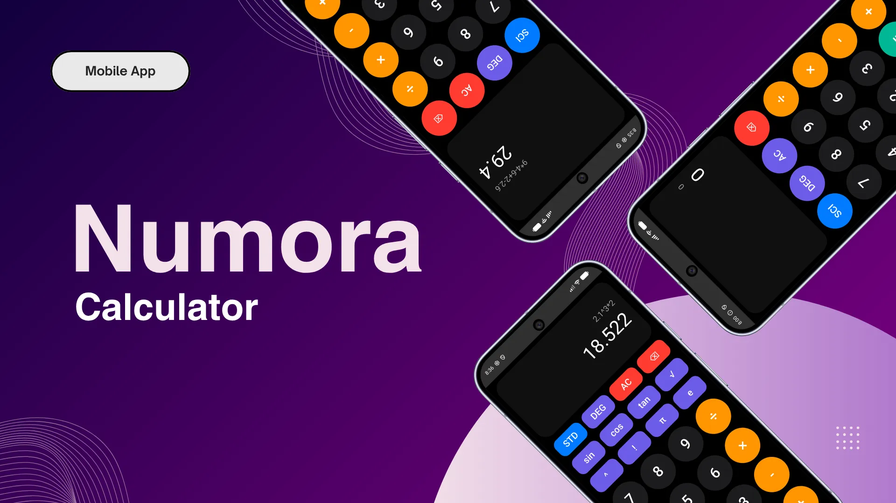
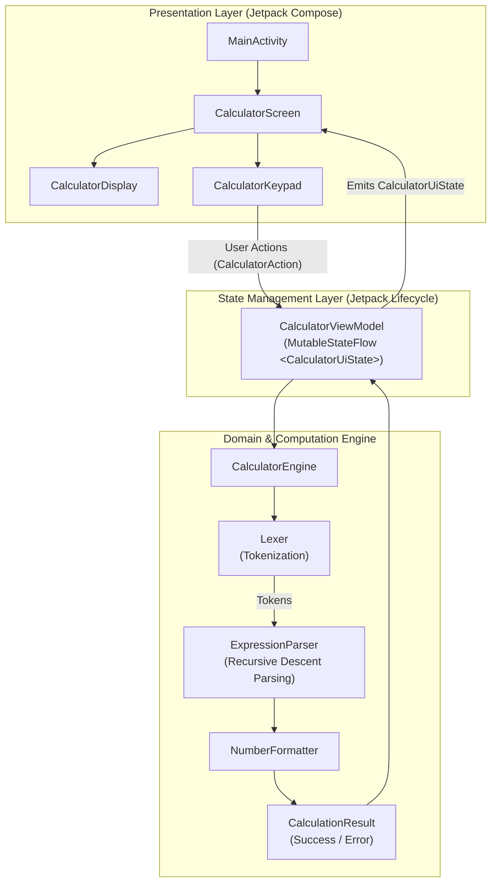
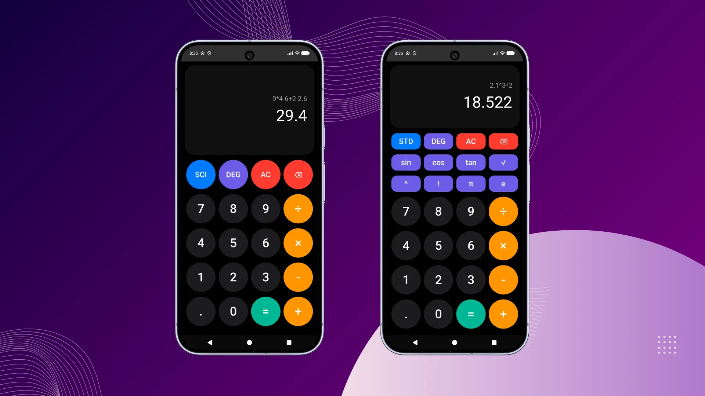

# Numora - Calculator




## Project Overview

Numora is a native Android calculator designed to provide an intuitive calculation experience that bridges everyday arithmetic with advanced scientific computation. Built modernly using Kotlin and Jetpack Compose, the application addresses the common friction in mobile calculators—cluttered interfaces, awkward mode switching, and rigid input parsing—by pairing a streamlined AMOLED-optimized user interface with a custom-engineered recursive descent mathematical parser. Geared toward students, engineers, and everyday mobile users, Numora provides instant evaluation, natural mathematical expression syntax with implicit multiplication, trigonometric operations in both degree and radian units, and dynamic typography that adapts fluidly to growing calculation strings.

## Key Features

- **Standard Arithmetic Calculation**: Evaluates basic mathematical operations (addition, subtraction, multiplication, and division) adhering strictly to standard operator precedence.
- **Collapsible Scientific Panel**: Smoothly reveals extended scientific tools—trigonometric functions (`sin`, `cos`, `tan`), power (`^`), factorial (`!`), square root (`√`), and mathematical constants (`π`, `e`)—via animated transitions.
- **Custom Recursive Descent Parser**: Parses raw mathematical strings through an internal lexer and tokenizer capable of resolving nested parentheses, unary negation, postfix percentages, and implicit multiplication (e.g., `2π` and `2(5)`).
- **Dual Angular Units (DEG & RAD)**: Offers one-touch switching between Degrees and Radians for trigonometric evaluations with accurate boundary checks.
- **Dynamic AMOLED Display**: Pure dark theme (`#000000`) crafted for OLED battery savings and visual clarity, featuring automated font downsizing as expression length increases.
- **Mathematical Safety & Error Resilience**: Validates calculation outputs against arithmetic overflow, invalid square roots, and division by zero, surfacing clear feedback rather than application crashes.

## Supported Platforms

| Platform | Operating System | Minimum Version | Support / Test Status |
| --- | --- | --- | --- |
| Mobile | Android | Android 8.0 (API Level 26)+ | Verified / Supported (Target SDK 37) |

## Tech Stack

| Category | Technology | Purpose |
| --- | --- | --- |
| Primary Language | Kotlin 2.2.10 | Core language for business logic, engine parsing, and UI implementation |
| UI Framework | Jetpack Compose (BOM 2026.02.01) | Declarative UI toolkit for reactive layout rendering and animations |
| Design System | Material 3 | Modern Android components, surface elevations, and adaptive themes |
| Architecture Pattern | MVVM (Model-View-ViewModel) | Unidirectional data flow and clear separation of concerns |
| Reactive State | Coroutines & StateFlow | Reactive state emission and asynchronous lifecycle handling |
| Mathematical Parser | Custom Lexer & Recursive Descent Parser | Mathematical tokenization, precedence analysis, and expression evaluation |
| Build Automation | Gradle 9.5.0 & AGP 9.3.2 | Compilation pipeline, dependency resolution, and packaging |
| Unit Testing | JUnit 4 | Unit verification of the tokenization, parsing rules, and ViewModel logic |
| Instrumentation Testing | AndroidX Compose UI Test & Espresso | Automated testing of UI layout components and button interactions |

## Application Architecture

Numora adheres strictly to the Model-View-ViewModel (MVVM) architecture with Unidirectional Data Flow (UDF). The presentation layer, built with Jetpack Compose, captures user keypad taps and converts them into strongly typed `CalculatorAction` events sent to `CalculatorViewModel`. The ViewModel acts as the single source of truth, managing expression state and delegating calculation tasks to `CalculatorEngine`. Within the engine, an in-house `Lexer` scans the character sequence into strongly typed `Token` objects, which `ExpressionParser` evaluates using a deterministic recursive descent grammar supporting operator precedence, associativity, and function calls. The resulting evaluated number is passed through `NumberFormatter` and returned as a `CalculationResult`, which the ViewModel emits back to the UI via Kotlin `StateFlow`.



## Screenshots / Preview

### 1. Standard Arithmetic & Scientific Calculator Modes

Side-by-side presentation of Numora Calculator in its default standard arithmetic view and its expanded scientific mode. The standard mode provides clean access to basic arithmetic operations with an emphasis on rapid input, while the scientific view expands with animated transitions to surface trigonometric functions, power, factorial, square root, constants, and angle mode toggling on an AMOLED dark background.

## Prerequisites

- **Android Studio**: Android Studio Ladybug / Koala or newer recommended.
- **Java Development Kit (JDK)**: JDK 11 or higher configured in the development environment.
- **Android SDK**: Android SDK Platform 37 installed, with build tools supporting API 26 minimum.
- **Physical Device or Emulator**: Android device running Android 8.0 (API Level 26) or higher.
- **Build System**: Gradle 9.5.0 wrapper (bundled within repository).

## Installation & Setup

1. Clone the repository from GitHub:
   ```bash
   git clone https://github.com/weztcy/Numora---Calculator.git
   cd "Numora - Calculator"
   ```

2. Open the project in Android Studio and ensure Gradle synchronization completes:
   ```bash
   ./gradlew --refresh-dependencies
   ```

3. Assemble the debug APK to verify build integrity:
   ```bash
   ./gradlew assembleDebug
   ```

4. Install and run the debug build on an active Android device or running emulator:
   ```bash
   ./gradlew installDebug
   ```

## Application Configuration

Numora utilizes standard Android Gradle build parameters and configuration constants embedded within the application model. No external secret keys or cloud endpoints are required to run the application.

| Configuration | Description | Default / Example |
| --- | --- | --- |
| `minSdk` | Minimum Android OS API level required to run the application | `26` (Android 8.0 Oreo) |
| `targetSdk` | Android SDK API level against which runtime behaviors are verified | `37` (Android Vanilla Ice Cream) |
| `compileSdk` | Android SDK version used to compile application source code | `37` |
| `angleMode` | Initial angular calculation mode for trigonometric evaluations | `AngleMode.DEG` (Degrees) |
| `scientificMode` | Initial visibility state of the scientific keypad expansion | `false` (Standard Mode) |
| `optimization.enable` | R8 code shrinking and obfuscation toggle for release builds | `false` |

## Testing

Numora includes a comprehensive automated test suite spanning unit tests for mathematical correctness and instrumented tests for Compose layout rendering.

- **Parser & Arithmetic Unit Tests**: Tests operator precedence, nested parentheses, right-associative power (`2^3^2 = 512`), factorials (`5! = 120`), square roots, implicit multiplication (`2π`), and trigonometric angle conversions in `CalculatorEngineTest` and `ExpressionParserTest`.
- **ViewModel State Tests**: Validates state updates, expression string manipulation, clearing, backspace, and error handling for division by zero in `CalculatorViewModelTest`.
- **Compose UI Tests**: Verifies UI component hierarchies and touch event handling via `androidx.compose.ui.test.junit4`.

```bash
# Execute local unit tests across engine, parser, and ViewModel
./gradlew test

# Execute Android instrumentation tests on a connected emulator or device
./gradlew connectedAndroidTest
```

## Build & Packaging

The application build pipeline is automated via Gradle and Android Gradle Plugin:

1. Compile and generate the standalone debug APK:
   ```bash
   ./gradlew assembleDebug
   ```
2. Build the unsigned production-ready release APK:
   ```bash
   ./gradlew assembleRelease
   ```
3. Generate the Android App Bundle (AAB) for distribution on Google Play:
   ```bash
   ./gradlew bundleRelease
   ```

Compiled APK artifacts are output to `app/build/outputs/apk/`, and App Bundles are generated in `app/build/outputs/bundle/`.

## Usage

Numora is designed for immediate, barrier-free mathematical entry with no login or setup flow required.

1. Launch the **Numora** application from your device home screen or app launcher.
2. Tap numeric keys (`0`–`9`) and primary arithmetic operators (`+`, `-`, `×`, `÷`) to construct mathematical expressions in the upper display.
3. Tap the **SCI** button to toggle the scientific function tray, revealing trigonometric operations (`sin`, `cos`, `tan`), exponential power (`^`), factorial (`!`), square root (`√`), and mathematical constants (`π`, `e`).
4. Toggle between **DEG** (Degrees) and **RAD** (Radians) depending on the desired angular context for trigonometric operations.
5. Tap the **=** button to evaluate the expression. The result is calculated instantly and displayed with dynamic auto-sizing.
6. Use the **⌫** (Backspace) key to remove characters individually or tap **AC** (All Clear) to reset the expression and result.

## Contributing

Contributions to Numora are welcome. To maintain code cleanliness and test reliability, please follow this contribution procedure:

1. Fork the repository on GitHub.
2. Create a dedicated feature or bugfix branch (`git checkout -b feature/scientific-function`).
3. Make your modifications adhering to Kotlin style guides and Jetpack Compose state best practices.
4. Run the unit test suite (`./gradlew test`) to ensure all mathematical rules and state assertions pass.
5. Commit your changes with clear, descriptive commit messages and push the branch to your fork.
6. Submit a Pull Request detailing the problem addressed, changes introduced, and test results.

## License

This project is licensed under the MIT License.
See the [LICENSE](LICENSE) file for details.

## Author & Contact

**Yohanes Dimas Pratama**

- GitHub: [github.com/weztcy](https://github.com/weztcy)
- Portfolio: [yohanesdimas.com](https://yohanesdimas.com)
- LinkedIn: [linkedin.com/in/yohanes-dimas](https://www.linkedin.com/in/yohanes-dimas)
